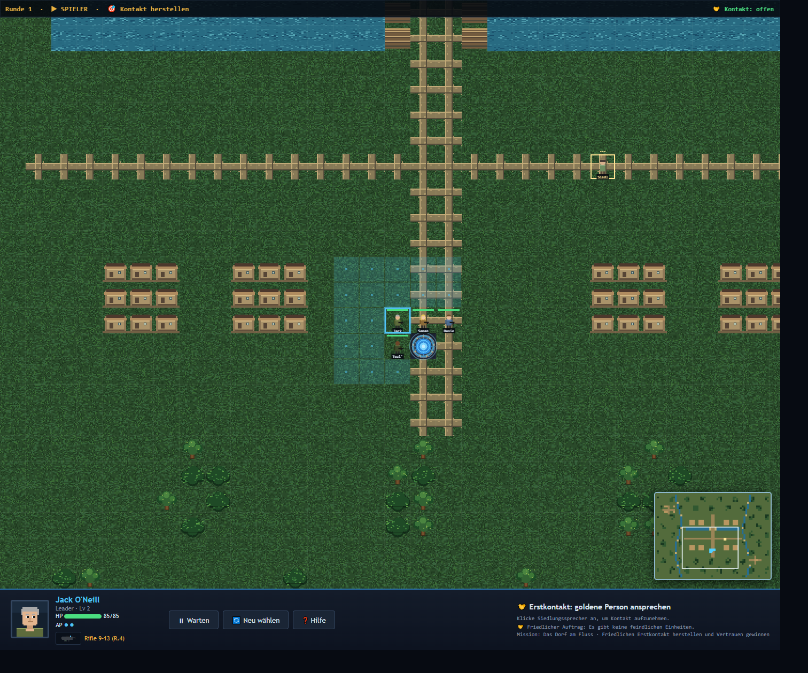

# Captain's Log 019 – Große Welten und friedlicher Erstkontakt

Die Einsatzkarte füllt nun die verfügbare Browserfläche statt als kleines Fenster im Overlay zu stehen. Die Welten sind auf 64×48 Felder angewachsen, und eine anklickbare Minimap zeigt Terrain, Team, Kontakte und den aktuellen Sichtausschnitt. Pfeiltasten, WASD und Ziehen auf der Karte bleiben als Kamerasteuerung erhalten.

## Mehr Landschaft, mehr Leben

Außenbereiche können nun Wälder, schmale Flüsse, Brücken, Wege und kleine Siedlungen enthalten. Die Abydos-Mission „Das Dorf am Fluss“ nutzt ein eigenes Layout mit Höfen, Häusern, Wegen und begehbaren Brücken.

## Diplomatie statt Feuergefecht

„Das Dorf am Fluss“ auf Abydos und die Kolonie-Mission auf Serenno sind friedliche Kontaktmissionen: Es gibt keine feindlichen Einheiten und keine Kampfpflicht. Die gold markierte Ansprechperson lässt sich über die Karte anwählen; SG-1 nähert sich ihr, startet ein Gespräch und schließt den Auftrag nach dem Dialog ab. Briefings, Feldgespräche und Missionsbelohnungen folgen demselben Kampagnenablauf wie bei Gefechten.

## Release Candidate

Der Kandidat umfasst die vergrößerten Gefechtskarten, den Erstkontakt, bisherige Basis- und Story-Verbesserungen sowie die dazugehörige Bedienungsdokumentation. Validierung umfasst JavaScript-Syntax, alle Missionskarten, Startpositionen und einen vollständigen Kontakt-/Dialogablauf im Browser.
