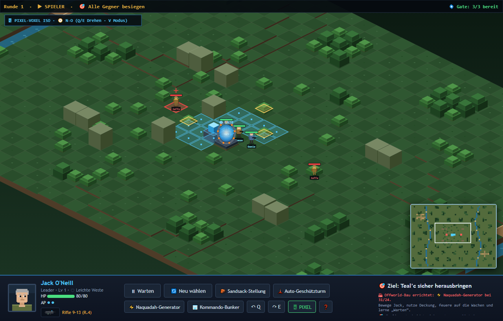
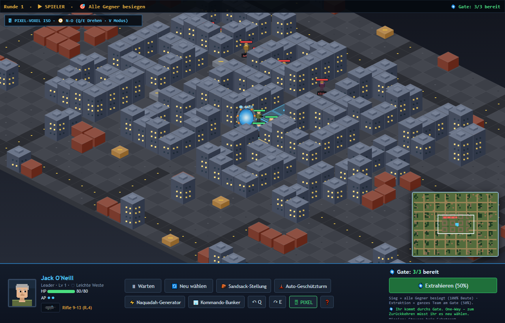
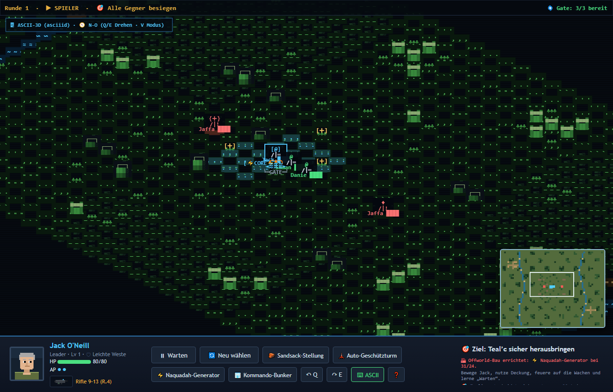
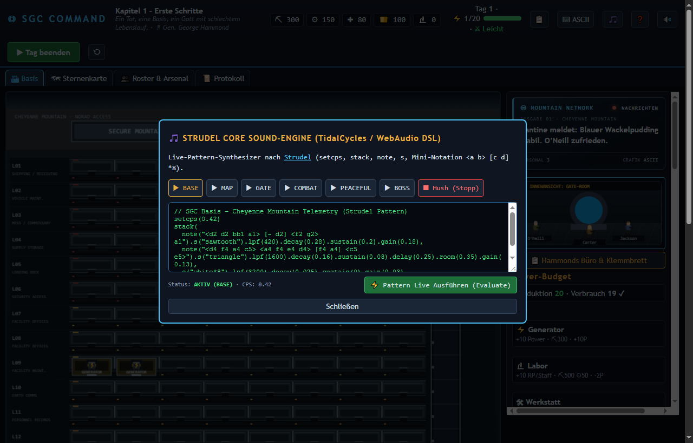
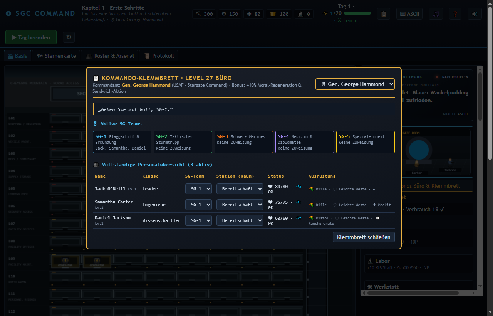
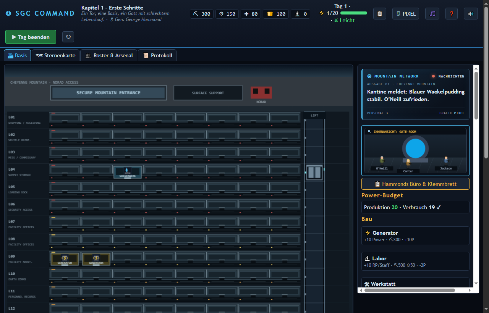

# Captain's Log 020 – Isometrische Voxel-Welten, Live-ASCII-3D (`asciiid`), Offworld-Basenbau & Strudel Sound-Engine

Mit **Version 0.20** erhält **SGC Command** das größte technische und visuelle Upgrade seit Projektbeginn: Das gesamte Spielfeld wurde auf eine **echte isometrische 2:1 Voxel-Projektion im Pixel-Art-Look** umgestellt – inklusive **Live-Umschaltung auf einen voll spielbaren 3D-ASCII-Modus** (inspiriert von `Tretboot/asciiid` und `msokalski/asciicker`), **Offworld-Basenbau** im Stil von *Command & Conquer* / *SimCity*, der **Strudel Core Sound-Engine** sowie den offenen Aufgaben aus `ROADMAP.md` und `INVENTAR-SPEC.md`.

---

## 1. Isometrisches Voxel-Gelände & Städtebau (`game/iso.js`)

Statt einer flachen 2D-Draufsicht berechnet `getVoxelInfo(x, y)` für jede Zelle der 64×48-Karte eine Grundhöhe (`baseZ`) und eine Strukturhöhe (`blockH`). Daraus entsteht ein plastisches Voxel-Terrain mit:
- **2:1 Pixel-Isometrie (`tileW: 64`, `tileH: 32`, `zStep: 14`)** und gerichteter Beleuchtung (Top-Diamond, linke und rechte Schattenflanke nach dem Vorbild von `obelisk.js` [MIT]).
- **4-Wege-Kameradrehung (`Q` / `E`)** in 90°-Schritten sowie exakt invertiertem Mouse-Picking (`isoScreenToTile`) über erhöhte Voxel-Hitboxen.
- **Skalierung auf ganze Städte (`city`):** Mehrstöckige Hochhäuser mit beleuchteten Fenstern, Straßenraster mit Fahrbahnmarkierungen und taktische Agenten zwischen den Häuserschluchten wie in *Syndicate*, *X-COM* und *Jagged Alliance*.

---

## 2. „Superkrasser Bonus“: Live umschaltbarer 3D-ASCII-Modus (`asciiid` / `asciicker`)

Über das Pause-Menü (`ESC`), den Header-Button (`🖥 PIXEL` / `⌨ ASCII`), das Kampf-HUD oder jederzeit per Hotkey **`V`** lässt sich die Darstellung ohne Neustart zwischen **Pixel-Voxel** und **3D-ASCII** umschalten – **beide Modi sind zu 100 % spielbar**:
- **CP437 / ASCII-Voxel-Pipeline:** Höhenkanten werden wie in `Tretboot/asciiid` (`render.cpp`) als Konturlinien (`─`, `_`) und schattierte Blöcke (`█`, `▓`, `▒`, `░`, `▀`, `▄`) gerendert.
- **Mehrzellige ASCII-Sprites:** SG-Agenten (`[@]` / `/|═`), Jaffa (`{+}`), 3D-ASCII-Stargate und gebaute Offworld-Generatoren (`[⚡CORE]`) werden tiefensortiert dargestellt.
- Auch die 28 Ebenen des **Cheyenne Mountain** und die **Raum-Innenansichten** besitzen einen eigenen grünen CRT/CP437-Terminal-Modus.

---

## 3. Offworld-Basenbau im Einsatz (Command & Conquer / SimCity)

Auf Offworld-Missionen können SG-Teams direkt im Gefecht über die Aktionsleiste Pionier-Strukturen errichten (`OFFWORLD_BUILDINGS`):
- **🧱 Sandsack-Stellung (10 ⛏):** Erzeugt sofortige Voxel-Deckung (+20 % Schutz).
- **🗼 Auto-Geschützturm (25 ⛏, 5 ⚙):** Feuert am Ende jeder Runde automatisch auf sichtbare Feinde in Reichweite 5 (`8–12` Schaden).
- **⚡ Naquadah-Generator (30 ⛏, 10 ⚙):** Regeneriert +4 HP pro Runde für alle eigenen Einheiten im Umkreis von 3 Feldern.
- **🏢 Kommando-Bunker (40 ⛏, 10 ⚙):** Massive Voxel-Deckung mit 110 Strukturpunkten.

---

## 4. Strudel Core Sound-Engine (`game/sound.js` & `game/vendor/strudel-web.js`)

Als Core Sound-Engine wurde **Strudel** (`https://urswilke.github.io/strudel/learn/getting-started/`) integriert:
- Das offizielle `@strudel/web@1.3.0` Bundle liegt lokal unter `game/vendor/strudel-web.js` (sowie in `references/strudel/`).
- Zusätzlich enthält `game/sound.js` einen **eigenen, MIT-sauberen Strudel-DSL-Compiler & WebAudio-Synthesizer**, der `setcps`, `stack`, `note`, `chord`, `s`, Mini-Notation (`<a b>`, `[c d]`, `white*8`, `~`) und Filterketten (`.lpf()`, `.decay()`, `.sustain()`, `.delay()`, `.room()`, `.gain()`) direkt ohne externe Netzwerkabhängigkeiten ausführt.
- Über den Header-Button **🎵** öffnet sich die **Strudel Live-Coding-Konsole**, in der alle 6 dynamischen Soundtracks (`base`, `map`, `gate`, `combat`, `peaceful`, `boss`) live editiert und neu evaluiert werden können.

---

## 5. Offene Aufgaben aus Roadmap & Inventar-Spec erledigt

- **Inventar, Waffenkammer & Werkbank (`INVENTAR-SPEC.md`):** Crafting und Ausrüstung für Waffen (`Zat'nik'tel`, `Stabwaffe`, `Shotgun`, `Rifle`), Rüstungen (`Leicht`, `Komposit`, `Naquadah-Platte`) und Spezial-Items (`Medkit`, `Persönlicher Schild`, `Rauchgranate`, `EMP-Impuls`).
- **Mehrere SG-Teams (`SG-1` bis `SG-5`):** Freischaltung über Kapitel, freie Zuweisung im Roster und Schnellwahl vor Missionsstart.
- **Hammonds Büro & Klemmbrett (`📋`):** Gesamtübersicht über alle Rekruten, Räume, Teams und Ausrüstung auf Level 27 – inklusive wechselbarem Kommandanten (**Gen. George Hammond**, **Dr. Elizabeth Weir**, **Gen. Hank Landry**) mit eigenen globalen Boni.
- **Einsehbare Raum-Innenansicht:** Klick auf einen Raum im Cheyenne Mountain zeigt live das animierte Innere (inkl. blauem Wackelpudding in der Kantine, Naquadah-Analysator im Labor und Stargate-Rampe).

