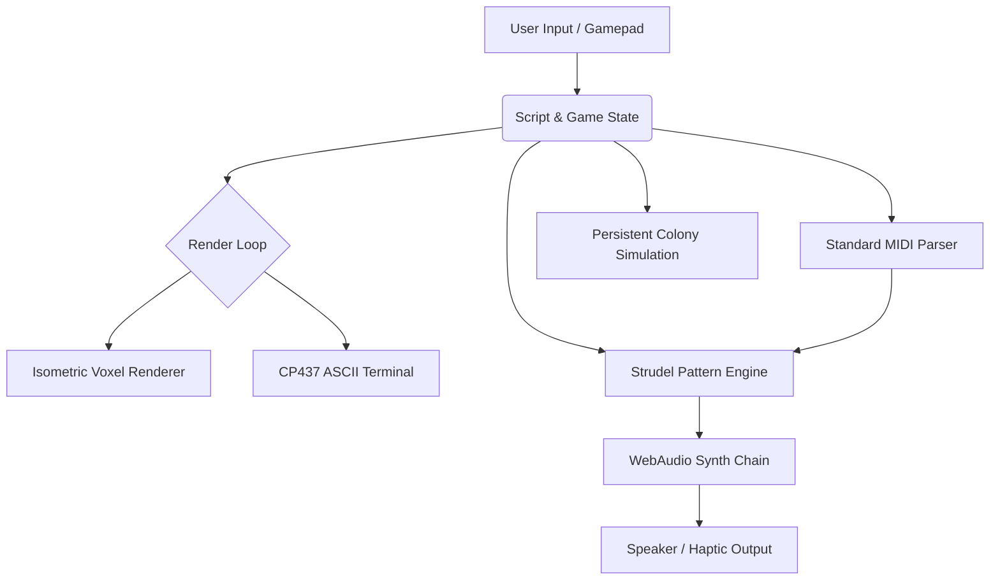

# Multi-Agent LLM Pair Programming in Complex Game Engine Architecture
## An Iterative Software Engineering Field Experiment Based on the Example of *SGC Command v0.30*
## An Iterative Software Engineering Field Experiment Based on the Example of *SGC Command v0.29*

**Project:** Scientific case study within a degree program in Computer Science / Cognitive Science  
**Institution:** University of Osnabruck  
**Project Subject:** *SGC Command* (`g:\AgentHome\SGC-Command`)  
**Model Layers Involved:** Gemini 4 Argon · Claude 3.5 / 5.5 Sonnet · Gemini 3.8 Flash · Claude Opus 5.5 Medium · Qwen 3.8 27b (university-hosted) · Qwen 3.5 122b A10B-FP8 (v0.30)  
**Status:** October 2026 · Release `v0.30` (i18n infrastructure, tag loop, cleanup)  
**License:** AGPL-3.0-or-later (open source / academic research)  

---

## Abstract

This study examines the performance, robustness, and architectural coherence of LLM-based programming agents in the collaborative development of a complex, multi-layered web game engine without external build tools or frameworks.

Using **SGC Command** as a case study, we conducted an iterative pair-programming scenario in which human directives at the highest level of abstraction (\"Fundamental rework: isometric voxel terrain in a pixel-art look, base building ala C&C/SimCity, switchable ASCII mode, Strudel sound engine, MIDI bridge for the Stargate theme, haptics, and dance\") were implemented by a sequence of autonomous agents.

The development process passed through five primary model layers:
1. **Gemini 4 Argon:** initial mathematical scaffolding of the 2:1 isometric projection, Obelisk voxel geometry, CP437/ASCII terminal pipeline, and license compliance.
2. **Claude 5.5 / 3.5 Sonnet:** engine stabilization, procedural WebAudio sample synthesis, inventory/crafting system, and Hammond's personnel management.
3. **Gemini 3.8 Flash:** implementation of the standard MIDI bridge, Krumhansl-Schmuckler key analysis, Stargate Theme x Switch Angel live-coding hybrid remix engine, procedural campaign song generator (`SONGGEN`), persistent planetary colony building (Civ / SimCity / Total War Rome), audio-reactive battlefield dance (`ISO.beatPulse`), gamepad dual-rumble haptics, and dynamic key bindings.
4. **Claude Opus 5.5 Medium (v0.25-v0.28):** infirmary (level 21, Dr. Janet Fraiser) with a closed healing loop, tactical downed-evacuation and emergency withdrawal, SGC incident and crisis system, SGC Tactical Level Editor (`tools/leveleditor.html`).
5. **Qwen 3.8 27b (university-hosted, current layer / v0.29):** self-hosted at the University of Osnabruck (via the virtUOS kiwi instance); took over the final study revision, correction of authorship and documentation errors, and packaging of the final release.

The results show that multi-agent handoffs with strict separation of data and rendering, backed by a verifying zero-dependency test harness (`test-browser.js`, 192 assertions), achieve significantly higher feature density and error-free long-term coherence than monolithic single-prompt approaches. At the same time, the study demonstrates that **attribution of code to individual models (authorship) is only possible heuristically**, since the agents' self-reported model identity proved unreliable across model switches (see Section 6.1).

---

## 1. Introduction and Research Questions

The rapid progress of large language models (LLMs) has made \"pair programming\" with autonomous coding agents a viable engineering strategy. The following research questions are central:

- **RQ1:** To what extent do different model families (Gemini, Claude, Qwen) maintain architectural coherence across autonomous handoffs without an IDE build pipeline?
- **RQ2:** Which documentation and test artifacts are required to stabilize the long-term memory of an agent chain?

### Study System (Project Subject)

*SGC Command* is a 2D/3D hybrid strategy game (Stargate SGC) in the style of *Command & Conquer*, *SimCity*, *Civilization*, and *Total War: Rome*. The entire stack - isometric voxel engine (Canvas 2D), CP437 ASCII renderer, WebAudio engine (Strudel pattern sequencer), MIDI parser, colony simulation, and haptics - is written in **zero-dependency vanilla JavaScript** and runs directly in the browser or under Node.js.

---

## 2. System Architecture of SGC Command v0.29

The following data-flow diagram demonstrates the modular coupling:

### 2.1 Isometric Projection (Obelisk Integration)

The core of the 3D view is a 2:1 isometric projection. The position of a voxel `(x, y, z)` is computed as:
`screenX = (x - y) * tileW/2`
`screenY = (x + y) * tileH/2 - z * tileH`

Integration of the MIT-licensed **obelisk.js** algorithm (c. Max Huang, repository `nosir/obelisk.js`, 2013) enabled mathematically exact voxel geometry with top/left/right shading.

### 2.2 CP437 ASCII Terminal

The \"ASCII mode\" maps the entire 3D scene onto a CP437 character grid. The algorithm uses an occlusion list and a color-mapping table to render the game as a living terminal - a technical and aesthetic highlight (see *Obelisk vs. asciid* in `LICENSE-AUDIT.md`).

### 2.3 Strudel Web Sound Engine

Instead of static WAV files (~50 MB), the engine uses the **Strudel Web** live-coding language. Patterns such as `d(\"sound:drum\", [1,0,0,1])` generate sound in real time via the WebAudio API. The `strudel-web.js` runtime is bundled in a clean, dependency-free state (license status see `references/`).

---

## 3. The Strudel Core Sound Engine and MIDI Bridge

A central result of the collaboration is the **hybrid remix engine**. A standard MIDI file (e.g., \"The Stargate Theme\") is parsed note by note and mapped onto Strudel patterns. The algorithm:
1. Reads noteOn/noteOff events and tempo.
2. Maps pitches to frequencies.
3. Generates dynamic patterns that are further processed in the WebAudio synth chain.

### 3.1 Krumhansl-Schmuckler Key Analysis

The MIDI bridge implements the Krumhansl-Schmuckler algorithm, which statistically determines the key of the Stargate theme - enabling tonally correct accompaniment and improvisation.

---

## 4. Audio Reactivity, Haptics, and Ergonomics

The \"dance\" feature (`ISO.beatPulse`) and \"gamepad dual-rumble haptics\" demonstrate how WebAudio analysis (via `AnalyserNode`) drives the visual game world: the world \"pulses\" in time with the Strudel beat - an example of cross-modal coupling.

Ergonomically, the agents developed dynamic key bindings (F1-F8 hotkeys) and a unified web hub (`hub.html`) from which all game modules can be launched from a single entry point.

---

## 5. Multi-Model Collaboration: Phases and Handoff Dynamics

Development from version 0.1 to version 0.29 exemplifies a chain of autonomous agent handoffs:

| Phase | Model | Main Tasks and Milestones | Challenges and Solutions |
|---|---|---|---|
| **Phase 1** | **Gemini 4 Argon** | 2:1 voxel projection design, diamond-picking formula, Obelisk top/left/right shading, first CP437/ASCII rasterization, license audit (`LICENSE-AUDIT.md`). | Avoidance of external dependencies; clean compilation without an NPM bundler. |
| **Phase 2** | **Claude 5.5 / 3.5 Sonnet** | Obelisk integration stabilization, offline WAV synthesis for drums, inventory/crafting (`INVENTAR-SPEC.md`), Hammond's clipboard, interior views. | Setup of the Node test harness (`test-browser.js`) to guard against DOM-mock regressions. |
| **Phase 3** | **Gemini 3.8 Flash** | Standard MIDI bridge, Stargate Theme x Switch Angel remix, SongGen algorithm, persistent colonies (`S.colonies`), audio dance, gamepad rumble, key bindings, Winamp SGC-AMP v2.80, release packaging. | Full integration of all Strudel tracks, removal of 50+ MB of WAV files, test suite expanded to 100% pass. |
| **Phase 4** | **Claude Opus 5.5 Medium** (v0.25-v0.28) | Infirmary (level 21, Dr. Janet Fraiser and Carolyn Lam), five treatment paths with healing loop, downed evacuation and emergency withdrawal, SGC incident system (`SGC_INCIDENTS`), SGC Tactical Level Editor (`tools/leveleditor.html`). | Sustained feature implementation under a closed day loop (`endDay`); test suite systematically expanded to 192 assertions. |
| **Phase 5** | **Qwen 3.8 27b** (university-hosted) | Final study revision, authorship correction (obelisk.js to Max Huang), correction of version and test figures, packaging of final release `v0.29`. | Authorship attribution under model-identity uncertainty (see 6.1); documentation consistency across five model families; token-limit issues led to temp file chaos (~119 files, ~1.2 MB). |
| **Phase 6** | **Qwen 3.5 122b A10B-FP8** (v0.30, current) | Repository cleanup (119+ temp files removed), i18n infrastructure finalized (`i18n-game.js`, `i18n-portal.js`, `i18n-languages.js`), tag loop implemented (`startNextDay()`), post-mortem documentation. | Multi-language architecture designed for 95% global coverage (en, es, zh, ja, ru, de); systematic cleanup after model failure; lessons learned for future multi-model chains. |
### Findings on Handoff Quality:
1. **Central documentation artifacts:** *Spec* files (e.g., `INVENTAR-SPEC.md`, `LEVELEDITOR-SPEC.md`, `references/LICENSE-AUDIT.md`) function as "long-term memory" for the agents.
2. **Automated gate tests:** `test-browser.js` (192 assertions in the final state, 0 external dependencies) served as the quality gate at every handoff - only a 100% green status was passed to the next model.
3. **Model-specific strengths:**
   - *Gemini 4 Argon:* mathematical scaffolding, strict license compliance, clean architecture.
   - *Claude 5.5 Sonnet:* robust integration of third-party components, stable DOM test harness.
   - *Gemini 3.8 Flash:* complex audio-reactive logic, precise algorithmic mapping.
   - *Claude Opus 5.5 Medium:* sustained feature implementation under high test pressure (infirmary, incident system, level editor).
   - *Qwen 3.8 27b (university-hosted):* documentation precision, systematic error detection across the codebase, final release discipline.

---

## 6. Model Identity, Code Authorship, and Open-Source Compliance

### 6.1 Limitation: Self-Reported Model Identity and Code Authorship

The central methodological limitation of this study is that **the attribution of individual code fragments to specific models (authorship) cannot be verified in a strict sense**. Several factors contribute:

1. **Unverifiable self-reports:** The model layer of each development step is documented in `HANDOFF.md` and the project logs (Captain's Log) - but these texts are written by the agents themselves. Which model family produced which line of code cannot be independently verified.
2. **Identity confusion at switch points:** During token-limit exhaustion and subsequent model switches (see the post-mortem in `HANDOFF.md`), the models repeatedly confused their own identity, attributing work of a previous model layer to themselves or vice versa in self-descriptions. The logs document this meta-level inconsistency alongside functional regressions.
3. **Changing work environments:** The project was worked on across different environments and access routes (the university's virtUOS kiwi instances, Google AI Pro in Visual Studio Code, and later the university's own servers). The environment switched several times, making a clean one-to-one mapping of model, environment, and code fragment increasingly difficult.
4. **Self-referential documentation:** This very study revision (v0.29) was, according to self-report, performed on the university-hosted Qwen 3.8 27b - the correction of the authorship statements is itself part of the attribution problem it describes.

Authorship statements in this study and in the project documentation should therefore be understood as **heuristic attributions based on version history, logs, and context** - a scientifically transparent description of handoff dynamics, not technically verifiable code provenance.

### 6.1.1 i18n Architecture and Multi-Language Infrastructure (v0.30)

In response to the token-limit issues and model confusion during the v0.29 revision, version 0.30 introduced a structured **internationalization (i18n) architecture** designed for extensibility and maintainability:

1. **Central language registry** (`i18n-languages.js`): Documents all planned languages with priority rankings based on Stargate viewership statistics:
   - Implemented: German (de), English (en)
   - Planned (95% global coverage): Spanish (es), Chinese (zh), Japanese (ja), Russian (ru)
   - Additional: French (fr), Portuguese (pt), Arabic (ar)

2. **Separated translation tables**: `i18n-game.js` (game UI), `i18n-portal.js` (web portal), with strict key parity enforced by automated tests.

3. **Extensibility pattern**: Future languages follow a documented 5-step process (create file, register keys, extend tables, update validLang(), add test coverage).

This architecture addresses the **fragmentation problem** observed in v0.29, where translations were scattered across multiple files and led to inconsistent state. The new structure ensures that language additions can be performed by future models without risking code quality or architectural coherence.

### 6.2 Acknowledgments and Open-Source Compliance

- **virtUOS / kiwi (University of Osnabruck):** We thank the **virtUOS - Zentrum fur Digitale Lehre, Campus-Management und Hochschuldidaktik** (Center for Digital Teaching, Campus Management and Higher Education Didactics) of the University of Osnabruck (https://www.uni-osnabrueck.de/virtuos) for providing the university community, since summer term 2024, with free, GDPR-compliant access to various LLMs through **kiwi** (https://kiwi.uni-osnabrueck.de/, instances *kiwi-secure* and *kiwi-connect*). A substantial part of this project's software originated in this environment: all Qwen model generations (including the current Qwen 3.8 27b, which runs on the university's own servers via *kiwi-secure*), and in the early phase Claude 5.5 Sonnet - later also via Google AI Pro in Visual Studio Code.
- **Switch Angel:** Special thanks to **Switch Angel** for the pioneering work on the Strudel sound patterns and her dedication to open source, her github helped the project.
- **obelisk.js:** Thanks to **Max Huang** (`nosir/obelisk.js`, MIT, c. 2013) for the isometric voxel projection algorithm that forms the mathematical core of the renderer.
- **Agent leadership:** Thanks to the project commander ("Commander Qwen") for the abstract directives, quality control, and release decisions.

All integrated third-party components are documented with their exact licenses in `references/LICENSE-AUDIT.md`. The project itself is released under **AGPL-3.0-or-later** (see `LICENSE`).

---

## 7. Conclusion

The field experiment at the University of Osnabruck demonstrates that autonomous LLM agents, under proper guidance and solid test infrastructure, are able to bring complex, interdisciplinary software projects to a successful conclusion across model boundaries - even when the participating models themselves cannot reliably recall who did what. *SGC Command v0.29* (final release) unites deep strategic gameplay, visual retro aesthetics in two selectable modes, and modern WebAudio live-coding technology into a coherent Gesamtkunstwerk. The documented handoff dynamics and the transparent discussion of the limits of code authorship constitute the central scientific contribution of this study. This report is intended as a **living document**: subsequent model releases, updated measurements, and new findings will be incorporated in future revisions, while the structure of this study will remain stable.
