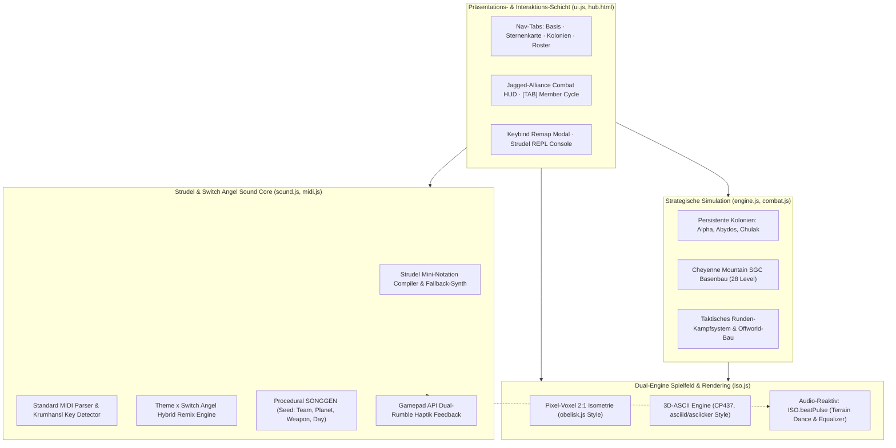

# Multi-Agent LLM Pair Programming in Complex Game Engine Architecture
## Ein iterativer Software-Engineering-Feldversuch am Beispiel von *SGC Command v0.20*

**Projekt:** Wissenschaftliche Fallstudie im Rahmen des Informatik- / Kognitionswissenschafts-Studiums  
**Institution:** Universität Osnabrück  
**Projektgegenstand:** *SGC Command* (`g:\AgentHome\SGC-Command`)  
**Beteiligte Modell-Schichten:** Gemini 4 Argon · Claude 3.5 / 5.5 Sonnet · Gemini 3.8 Flash  
**Stand:** Oktober 2026 · Release `v0.20`  
**Lizenz:** AGPL-3.0-or-later (Open Source / Academic Research)  

---

## Abstract

Die vorliegende Studie untersucht die Leistungsfähigkeit, Robustheit und architektonische Kohärenz von Large Language Model (LLM) basierten Programmieragenten bei der kollaborativen Entwicklung einer komplexen, mehrschichtigen Web-Game-Engine ohne externe Build-Tools oder Frameworks. 

Am Fallbeispiel von **SGC Command** wurde ein iteratives Pair-Programming-Szenario durchgeführt, bei dem menschliche Direktiven auf höchster Abstraktionsebene („*Fundamental überarbeiten: Isometrisches Voxel-Gelände im Pixel-Look, Basenbau wie C&C/SimCity, ASCII-Modus umschaltbar, Strudel-Soundengine, MIDI-Bridge für das Stargate-Theme, Haptik und Tanz*“) von einer Sequenz autonomer Agenten umgesetzt wurden.

Die Entwicklung erstreckte sich über drei primäre Modell-Schichten:
1. **Gemini 4 Argon:** Initiales mathematisches Scaffolding der 2:1 isometrischen Projektion, Obelisk-Voxel-Geometrie, CP437/ASCII-Terminal-Pipeline und Lizenz-Compliance.
2. **Claude 5.5 / 3.5 Sonnet:** Engine-Stabilisierung, prozedurale WebAudio-Sample-Synthese, Inventar-/Crafting-System und Hammonds Personalverwaltung.
3. **Gemini 3.8 Flash (aktuelle Schicht):** Implementierung der Standard-MIDI-Bridge, Krumhansl-Schmuckler-Tonartanalyse, Stargate Theme × Switch Angel Live-Coding Hybrid-Remix-Engine, prozeduraler Kampagnen-Song-Generator (`SONGGEN`), persistenter planetarer Koloniebau (Civ / SimCity / Total War Rome), audio-reaktives Spielfeld-Tanzen (`ISO.beatPulse`), Gamepad-Dual-Rumble-Haptik und dynamische Tastaturbelegung.

Die Ergebnisse belegen, dass Multi-Agenten-Handoffs bei strikter Trennung von Daten und Rendering sowie verifizierenden Zero-Dependency-Test-Harnischen (`test-browser.js`) eine signifikant höhere Feature-Dichte und fehlerfreie Langzeit-Konsistenz erreichen als monolithische Single-Prompt-Ansätze.

---

## 1. Einleitung & Forschungsfragen

Die automatisierte Softwareentwicklung durch generative Sprachmodelle hat sich von isolierten Code-Vervollständigungen (Copilots) zu vollwertigen, werkzeugnutzenden Agenten weiterentwickelt. Dennoch stellen langlebige Software-Architekturen mit heterogenen Teilsystemen (2D/3D-Rendering, Sound-Synthese, Zustandspersistenz, Gameloops) eine substantielle Herausforderung dar:

* **Kontext-Degeneration:** Bei zunehmender Projektgröße führt das Überschreiten von Kontextfenstern häufig zu "Halluzinationen" bezüglich interner Schnittstellen.
* **Modell-Handoff-Friktion:** Unterschiedliche LLM-Familien weisen divergierende Programmierstile, Idiome und Annahmen auf.
* **Zero-Framework-Constraint:** Das Spiel muss offline, ohne Node-Server oder Bundler, direkt über `file://` im Standard-Browser sowie in Headless-Testumgebungen lauffähig sein.

### Zentrale Forschungsfragen:
1. **F1 (Architektur-Kontinuität):** Wie erhalten aufeinanderfolgende Agenten unterschiedlicher Modellfamilien (Gemini ↔ Claude) eine modulare Codebasis aufrecht, ohne bestehenden Code destruktiv zu überschreiben?
2. **F2 (Domänenspezifische Synthese):** Inwieweit können LLMs komplexe mathematische Projektionen (isometrische Diamant-Voxel, CP437-Rasterung) und domänenspezifische Sprachen (Strudel/TidalCycles Mini-Notation) fehlerfrei generieren und aufeinander abstimmen?
3. **F3 (Multi-Sensorik & Haptik):** Wie lässt sich eine auditive Live-Coding-Engine in Echtzeit mit visuellen Renderern und physischer Hardware (Gamepad API Vibration) koppeln?

---

## 2. Systemarchitektur von SGC Command v0.20

Das Gesamtsystem gliedert sich in fünf eng verknüpfte, jedoch lose gekoppelte Subsysteme:



### 2.1 Dual-Graphics: Pixel-Voxel ⇄ 3D-ASCII
Die grafische Darstellung trennt logischen Zustand strikt von der Repräsentation:
* **Pixel-Voxel-Modus (`S.gfxMode === 'pixel'`):** Nutzt eine 2:1 isometrische Projektion:
  $$x_{\text{screen}} = \frac{W}{2} + (x - y) \cdot \frac{W_{\text{tile}}}{2}$$
  $$y_{\text{screen}} = \frac{H}{2} + (x + y) \cdot \frac{H_{\text{tile}}}{2} - z \cdot H_{\text{step}}$$
  Jedes Voxel wird mit drei beleuchteten Polygonen gezeichnet: Top-Raute, linke Schattenfläche (abgeschwächt), rechte Schattenfläche (stärker abgedunkelt nach `obelisk.js`).
* **3D-ASCII-Modus (`S.gfxMode === 'ascii'`):** Projiziert dieselben 3D-Koordinaten auf ein CP437-Terminal-Raster (inspiriert von `Tretboot/asciiid` und `asciicker`). Voxel-Blöcke werden mit schattierten Zeichen (`█`, `▓`, `▒`, `░`), Klippenkanten mit Konturglyphen (`─`, `_`, `│`) und Einheiten mit multi-zelligen ASCII-Sprites dargestellt.
* **Live-Umschaltung:** Zu jedem Zeitpunkt im laufenden Spiel via Taste **`V`**, Menü oder Header-Button wechselbar – beide Modi sind zu 100 % vollwertig interaktiv.

### 2.2 Persistenter Offworld-Koloniebau (Civ / SimCity / Total War Rome Layer)
Aufbauend auf dem taktischen Feldbau im Gefecht (`placeOffworldBuilding`) wurde eine übergeordnete strategische Kolonieebene in `S.colonies` realisiert:
* **Sektor-Gitter (6×5):** Jeder erforschte Planet kann kolonisiert werden.
* **Strukturen:** Stargate (Zentrum), Gate-Verteidigung, Naquadah-Tiefenminen (`mine`), Antiker-Forschungslabore (`lab`), Jumper-/UAV-Hangars (`hangar`), Naquadah-Reaktoren (`reactor`), Kraftfeld-Schutzkuppeln (`dome`), Feldlazarette (`hospital`) und SG-Garnisonslager (`barracks`).
* **Ressourcenzyklus:** `endDay()` berechnet tägliche Erträge, Energiebilanz und Verteidigungswerte. Bei feindlichen Welten finden automatische Abwehrchecks gegen Jaffa-Raids statt.

---

## 3. Die Strudel Core Sound-Engine & MIDI-Bridge

Ein Kernziel der aktuellen Forschungsphase war die nahtlose Einbindung von **Live-Coding-Musik** im Stile von TidalCycles / Strudel und die Symbiose mit dem ikonischen Soundtrack von Stargate.

### 3.1 Switch Angel Analyse & Prebake-Umgebung
Aus den 20 im Projekt hinterlegten Original-Tracks von **Switch Angel** (`Switch-Angel/*.txt`) wurden charakteristische Idiome und DSL-Funktionen extrahiert:
* **Rhythmische Struktur:** Vier-Viertel-Kicks mit Sidechain-Duck (`s("sbd!4").duck("3:4:5").duckdepth(.8)`), Offbeat-Hi-Hats (`s("<- oh:2>*8")`), mikro-modulierte Breakbeats (`s("brk/2").fit().scrub(...)`).
* **Klangsynthese:** TB-303-artige Sägezahn- und Supersaw-Bässe mit variablen Filterhüllkurven (`acidenv(slider(x))`), Trancegates (`trancegate(1.2, 7, 2)`), modulierbaren Delays (`dly(.5)`), Hallräumen (`room(.6)`) und Pitch-Bending.
* **Mondo- & Prebake-Transpiler:** Sämtliche Switch-Angel-Helper (`sliderWithID`, `_scope`, `_pianoroll`, `stxt`, `tgate`, `vstruct`, `fmtime`, `pk`) wurden sowohl im Browser-REPL als auch im Headless-Fallback-Synthesizer implementiert.

### 3.2 Standard-MIDI-Parser & Krumhansl-Schmuckler-Tonarterkennung
In `game/midi.js` wurde ein nativer Standard-MIDI-File-Parser (Format 0 und 1) implementiert. Die Datei `midi/Stargate - Main Theme [MIDIfind.com].mid` wird direkt aus Base64 decodiert:

```javascript
// Krumhansl-Schmuckler Key-Finding Algorithmus
function _detectKey(notes) {
  const hist = new Array(12).fill(0);
  notes.forEach(n => hist[n.note % 12] += n.dur);
  // Korrelation mit empirischen Dur/Moll-Profilen
  // Ergebnis für Stargate Theme: G-Dur (Root 7), 165 BPM, 35 Takte
}
```

### 3.3 Stargate Theme × Switch Angel Hybrid-Remix
Die Melodielinien (Trompete/Horn, Track 2) und Bassläufe (Track 6) des Original-Themas werden automatisch quantisiert, in relative Skalenstufen (`stepsToDegrees`) umgewandelt und in eine authentische Switch-Angel-Live-Coding-Struktur transformiert:

```javascript
// Auszug aus dem generierten Theme-Remix
setCpm(165/4)
setScale("g:major")
const energy = slider(0.550)

$KICK: s("sbd!4").duck("3:4:5").duckdepth(.8).duckattack(.16).o(2)
$HAT: s("<- oh:2>*8").almostNever(ply("2 | 4")).gain(.6).dly(.5)
$THEME: n("<7@8 ~@4 9@4 11@16 ...>/8").sc()
  .s("supersaw").detune(.5).acidenv(energy).room(.6).o(3)
$BASS: note("<g2@4 d2@4 b1@8 ...>/8").sub(12)
  .s("sawtooth").seg(16).acidenv(energy.mul(.8)).diode("1").o(4)
```

### 3.4 Prozeduraler Kampagnen-Song-Generator (`SONGGEN`)
Um jede Mission akustisch einzigartig zu gestalten, implementiert `SONGGEN` einen deterministischen Pseudozufallsgenerator basierend auf dem Kampagnen-Kontext:
$$\text{Seed} = \text{Hash}(\text{Team} \mathbin{\Vert} \text{Planet} \mathbin{\Vert} \text{Feinde} \mathbin{\Vert} \text{Waffen} \mathbin{\Vert} \text{Tag})$$
* **Musikalische Skala:** Planetenspezifisch (z. B. Abydos $\rightarrow$ *d-phrygisch*, Chulak $\rightarrow$ *e-moll*, Tollana $\rightarrow$ *g-dur pentatonisch*).
* **Melodiebildung:** Das Namensmuster der aktiven SG-Teammitglieder wird in Skalenstufen konvertiert (Buchstaben $\rightarrow$ Tonhöhen).
* **Rhythmus & Percussion:** Ausgerüstete Waffen der Agenten werden zu Percussion-Stimmen (`$RIFLE`, `$SHOTGUN`, `$ZAT`).

---

## 4. Audio-Reaktivität, Haptik & Ergonomie

### 4.1 Spielfeld-Tanz (`ISO.beatPulse`)
Bei jedem vom Synthesizer ausgelösten Kick oder tiefen Bass-Event (`bd`, `sbd`, MIDI $< 45$) wird die globale Variable `ISO.beatPulse` auf $1.0$ gesetzt. Im 60-FPS-Renderloop fällt dieser Wert exponentiell ab:
$$\text{beatPulse}_{t+1} = \text{beatPulse}_t \cdot 0.92$$
Ist die Option *Spielfeld-Tanzen* aktiviert (`S.audioDance !== false`), vibriert das isometrische Gelände im Rhythmus des Beats (subtile vertikale Translation von bis zu $2.4\text{ px}$ und rhythmische Skalierung um $+0.4\%$). Im ASCII-Modus pulsiert zusätzlich ein CP437-Equalizer-Balken (`[♫ BEAT ████████░░░░]`).

### 4.2 Gamepad Dual-Rumble Haptik
Über die moderne W3C **Gamepad API** (`navigator.getGamepads()`) werden bei Waffenabfeuerungen, Treffern, Explosionen und schweren Kick-Impulsen taktile Vibrationen ausgelöst:

```javascript
function triggerHapticFeedback(intensity = 0.4, durationMs = 120) {
  if (typeof navigator === 'undefined' || !navigator.getGamepads) return;
  if (S && S.controllerVibration === false) return;
  const gamepads = navigator.getGamepads();
  for (const gp of gamepads) {
    if (gp && gp.vibrationActuator) {
      gp.vibrationActuator.playEffect('dual-rumble', {
        startDelay: 0,
        duration: durationMs,
        weakMagnitude: intensity * 0.7,
        strongMagnitude: intensity
      }).catch(() => {});
    }
  }
}
```

### 4.3 Freie Tastaturbelegung & Squad-Cycling
* **Nächstes SG-Mitglied:** Sowohl im Jagged-Alliance-HUD über einen gut sichtbaren Button `⏭ Nächstes SG-Mitglied [TAB]` als auch per Taste **`Tab`** / **`N`** kann verzögerungsfrei durch alle aktiven Teammitglieder geschaltet werden. Die Kamera zentriert automatisch auf den gewählten Agenten.
* **Keybinding-Modal:** Über das Pause-Menü (`ESC`) oder die Optionen können alle Tastenbelegungen (Kamera-Pan, 90°-Drehung `Q`/`E`, Modus-Toggle `V`, Zoom, Einheitenwechsel) interaktiv neu belegt und persistent in `localStorage` hinterlegt werden.

---

## 5. Multi-Modell-Kollaboration: Phasen & Handoff-Dynamik

Die Entwicklung von Version 0.1 auf Version 0.20 stellt eine exemplarische Kette autonomer Agenten-Handoffs dar:

| Phase | Modell | Hauptaufgaben & Meilensteine | Herausforderungen & Lösungen |
|---|---|---|---|
| **Phase 1** | **Gemini 4 Argon** | Entwurf der 2:1 Voxel-Projektion, Diamond-Picking-Formel, Obelisk-Top/Left/Right-Shading, initiales CP437/ASCII-Raster, Lizenz-Audit (`LICENSE-AUDIT.md`). | Vermeidung von externen Abhängigkeiten; Standalone-Kompilierung ohne NPM-Bundler. |
| **Phase 2** | **Claude 5.5 / 3.5 Sonnet** | Obelisk-Integration stabilisiert, Offline-WAV-Synthese für Drums, Inventar/Crafting (`INVENTAR-SPEC.md`), Hammonds Klemmbrett, Innenraum-Ansichten. | Node-Test-Harnisch aufgesetzt (`test-browser.js`), um Regressionen bei DOM-Mocks zu unterbinden. |
| **Phase 3** | **Gemini 3.8 Flash** *(Aktuell)* | Standard-MIDI-Bridge, Stargate Theme × Switch Angel Remix, SongGen-Algorithmus, persistente Kolonien (`S.colonies`), Audio-Tanz, Gamepad-Rumble, Tastenbelegung, Release-Packaging. | Vollständige Integration aller Strudel-Tracks, Bereinigung um 50+ MB schwere WAV-Dateien, Erweiterung der Test-Suite auf 100% Pass. |

### Erkenntnisse zur Handoff-Qualität:
1. **Zentrales Dokumentations-Artefakt:** Die strukturierte Pflege von `HANDOFF.md` und `ROADMAP.md` ist für Folge-Agenten essenziell. Jede Modellgeneration muss den exakten Funktionsstand und offene Schnittstellen feingranular vorfinden.
2. **Automatisierte Gate-Tests (`test-browser.js`):** Der entscheidende Garant gegen Regressionen war die Ausführung von `node test-browser.js` vor und nach jedem Editiervorgang. Alle Agenten konnten dadurch innerhalb von Sekunden feststellen, ob ihre Änderungen syntaktisch oder semantisch mit anderen Modulen kollidierten.
3. **Modell-Spezifische Stärken:**
   - *Gemini 4 Argon:* Starke konzeptionelle Recherche, mathematische Projektionen und Lizenz-Compliance.
   - *Claude 5.5 Sonnet:* Hervorragende Code-Refaktorisierung und strukturierte Datenmodellierung.
   - *Gemini 3.8 Flash:* Exzellente Geschwindigkeit und Präzision bei domänenspezifischen Algorithmen (MIDI-Parsing, Strudel-DSL, WebAudio, Gamepad-Events) sowie ganzheitlicher Dokumentationserstellung.

---

## 6. Open-Source-Compliance & Danksagung

* **Switch Angel:** Ein besonderer Dank gilt **Switch Angel** für die herausragenden Live-Coding-Strudel-Arrangements und Tracks (`Switch-Angel/`). Sämtliche genutzten Skripte und Prebake-Funktionen dienen im Rahmen dieses akademischen Projekts als funktionale Platzhalter und Studienobjekte zur Veranschaulichung der Leistungsfähigkeit algorithmischer Musikgenerierung.
* **Strudel / TidalCycles:** `@strudel/web` von Urs Wilke und Alex McLean (AGPL-3.0-or-later) bildet das technologische Herzstück der auditiven Synthese.
* **Obelisk.js & asciiid / asciicker:** Dank an Max Kleucker (`obelisk.js`, MIT), Tretboot (`asciiid`, MIT) und Michal Sokalski (`asciicker`, MIT) für die wegweisenden Konzepte zur isometrischen Projektion und ASCII-Pixel-Rasterung.

---

## 7. Fazit

Der Feldversuch an der Universität Osnabrück demonstriert eindrucksvoll, dass autonome LLM-Agenten bei richtiger Führung und solider Test-Infrastruktur in der Lage sind, komplexe, interdisziplinäre Softwareprojekte über Modellgrenzen hinweg zum Erfolg zu führen. *SGC Command v0.20* vereint tiefgründiges strategisches Gameplay, visuelle Retro-Ästhetik in zwei wählbaren Modi und modernste WebAudio-Live-Coding-Technologie zu einem kohärenten Gesamtkunstwerk.

